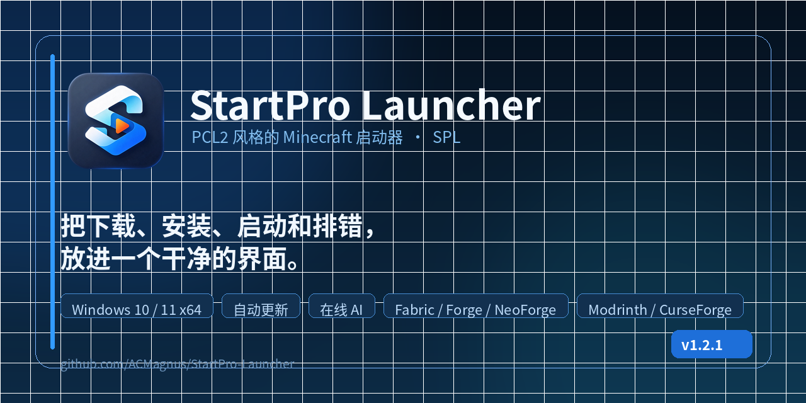
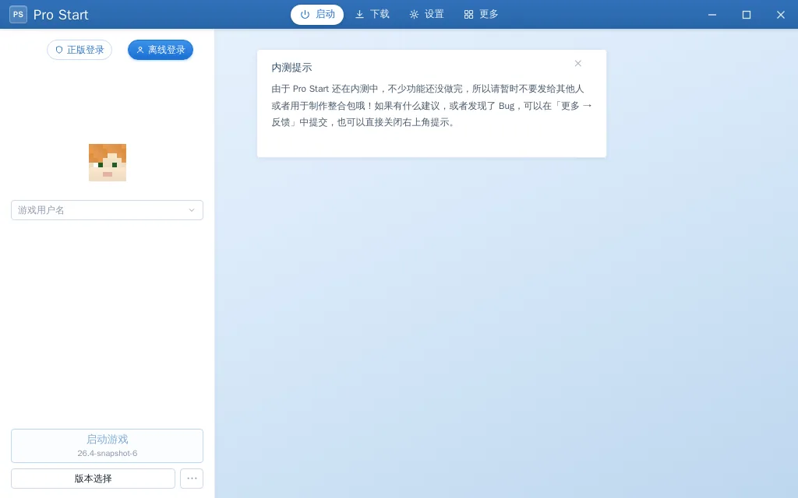
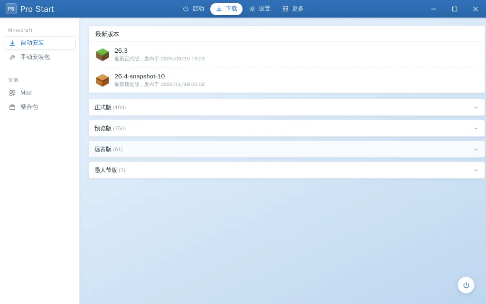
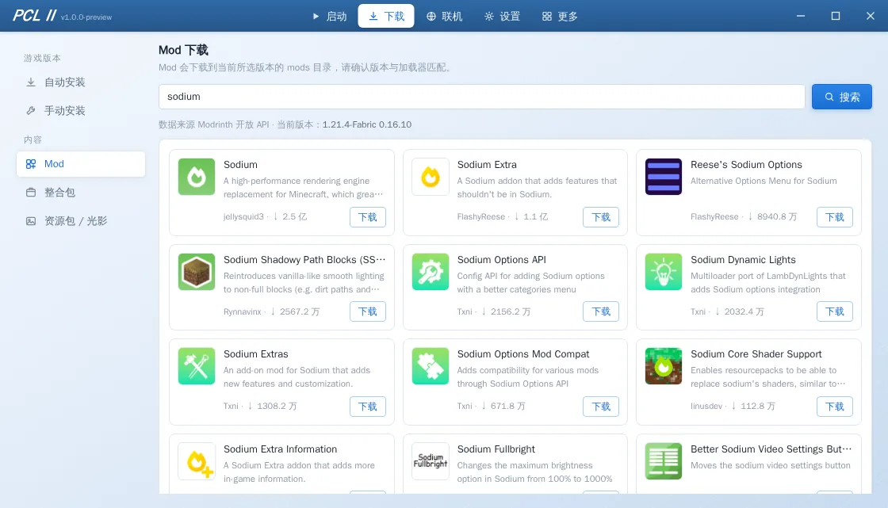
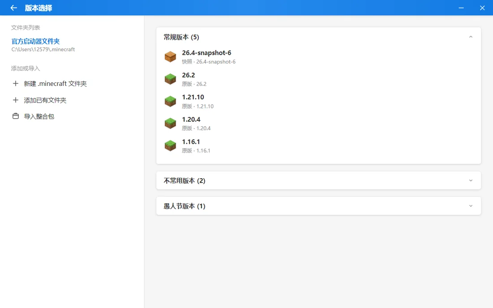
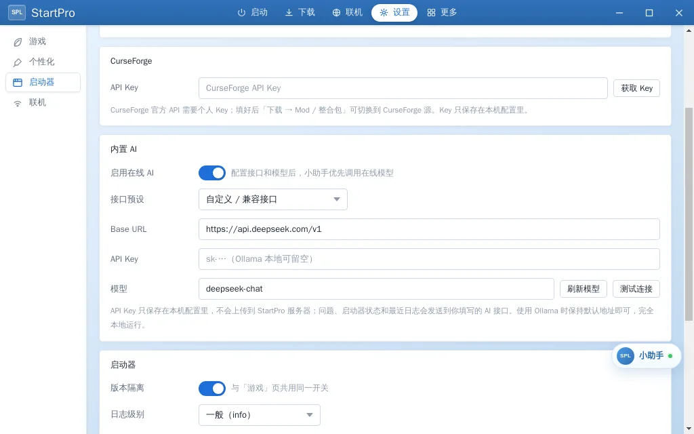

<div align="center">



# StartPro Launcher

**PCL2 风格的 Minecraft 启动器 · Windows 10 / 11 x64**

把版本下载、加载器安装、Mod 管理、启动和排错，放进一个干净的界面。

*A PCL2-style Minecraft launcher for Windows — real downloads, mod loader install, one-click updates and a configurable AI assistant.*

[](https://github.com/ACMagnus/StartPro-Launcher/releases/latest)
[](https://github.com/ACMagnus/StartPro-Launcher/releases)
[](https://github.com/ACMagnus/StartPro-Launcher/stargazers)
[](#下载)

[**下载 Windows 完整包**](https://github.com/ACMagnus/StartPro-Launcher/releases/download/v1.2.1/StartPro-Launcher-1.2.1-bat.zip) ·
[**下载源码**](https://github.com/ACMagnus/StartPro-Launcher/releases/download/v1.2.1/StartPro-Launcher-1.2.1-source.zip) ·
[**官方网站**](https://acmagnus.github.io/StartPro-Launcher/) ·
[**问题反馈**](https://github.com/ACMagnus/StartPro-Launcher/issues) ·
[**讨论区**](https://github.com/ACMagnus/StartPro-Launcher/discussions)

</div>

---

## 为什么是 StartPro Launcher

StartPro Launcher（SPL）不是只画了一层启动器外壳。它的下载、安装、启动、更新和 AI 助手都走真实的本地链路。

- **真实下载**：版本清单优先走 BMCLAPI，失败自动回退 Mojang 官方源。
- **加载器齐全**：原版、Forge、NeoForge、Fabric、Quilt、OptiFine。
- **资源生态**：Modrinth 全量搜索，CurseForge 支持官方 Key 与免 Key 两种模式。
- **自动更新**：启动后自动检查新版本，一键下载、SHA-256 校验、退出替换并重新打开；配置和存档不受影响。
- **在线 AI**：小助手可接 DeepSeek、OpenAI、Ollama 或任意 OpenAI 兼容接口，回复流式逐字显示，并自动带上当前版本、Java、镜像和最近日志。
- **本地优先**：账号、设置、皮肤和背景保存在本机；不登录也能用，不配置 AI 时对话完全离线。
- **源码公开**：完整 Electron 源码就在 [`source/`](source/) 目录，`main.js`、`core/`、`renderer/` 都能直接阅读和构建。
- **PCL2 风格界面**：主页、下载、版本、Mod、联机、设置、更多，操作习惯不用重新学。

## 界面

| 主页 | 下载 |
| --- | --- |
|  |  |

| Mod 搜索 | 版本管理 |
| --- | --- |
|  |  |

| 内置 AI |
| --- |
|  |

## 下载

当前版本：**1.2.1**

| 文件 | 说明 |
| --- | --- |
| [StartPro-Launcher-1.2.1-bat.zip](https://github.com/ACMagnus/StartPro-Launcher/releases/download/v1.2.1/StartPro-Launcher-1.2.1-bat.zip) | Windows 完整包，约 100 MB，内置 Electron，**不需要 Node.js** |
| [StartPro-Launcher-1.2.1-source.zip](https://github.com/ACMagnus/StartPro-Launcher/releases/download/v1.2.1/StartPro-Launcher-1.2.1-source.zip) | 源码包；仓库 [`source/`](source/) 目录同样保留完整源码 |
| [官网](https://acmagnus.github.io/StartPro-Launcher/) | 在线介绍与下载页 |

### 快速开始

1. 下载并解压 `StartPro-Launcher-1.2.1-bat.zip`。
2. 双击 `start.bat`，或直接双击 `StartPro Launcher.exe`。
3. 首次启动会创建配置目录 `%APPDATA%\StartPro Launcher`，不会接管你现有的 `.minecraft`。
4. 在「设置 → 游戏 → 游戏目录」切换到自己的 `.minecraft`，或直接安装一个新版本。

## 内置 AI 怎么用

入口：**设置 → 启动器 → 内置 AI**；也可以在小助手窗口点「AI 设置」。

1. 选择接口预设：DeepSeek、OpenAI、Ollama 本地，或自定义兼容接口。
2. 填 Base URL、API Key 和模型名，点「测试连接」。
3. 连接成功后，小助手顶部会显示「在线 AI · 模型名」，回复会流式逐字显示。

常用配置：

| 接口 | Base URL | 模型 |
| --- | --- | --- |
| DeepSeek | `https://api.deepseek.com/v1` | `deepseek-chat` |
| OpenAI | `https://api.openai.com/v1` | `gpt-4o-mini` |
| Ollama 本地 | `http://127.0.0.1:11434/v1` | `qwen2.5:7b` 或已拉取的模型 |

> API Key 只保存在本机 `%APPDATA%\StartPro Launcher\config.json`，不会上传到 StartPro 服务器。提问时会把问题、启动器状态和最近日志发送到你填写的 AI 接口；不配置时使用离线知识库。

## 自动更新

- 1.2.0 及之后版本启动约 4 秒后自动检查 `update.json`。
- 发现新版本会下载完整包、校验 SHA-256，并在退出后替换程序文件、重新打开。
- 自动更新只替换程序目录，不碰 `%APPDATA%\StartPro Launcher` 里的配置和游戏目录。
- 1.1.8 及更早版本没有自动更新代码，需要手动安装一次 1.2.1。

## 从源码运行

仓库内已经保留完整源码，位于 [`source/`](source/)：

```bash
git clone https://github.com/ACMagnus/StartPro-Launcher.git
cd StartPro-Launcher/source
npm install
npm start
```

构建 Windows 包：

```bash
npm run dist
```

`source/start.bat` 的行为：
- 完整包里有 `StartPro Launcher.exe` 时直接启动，不要求 Node.js。
- 没有 exe 时回退到 `npm install` + Electron。

## 项目结构

```text
index.html           官网首页，由 GitHub Pages 直接托管
update.json          启动器自动更新清单
screenshots/         README 与社交预览图
source/              完整 Electron 源码
  core/              下载、启动、Java、加载器、Mod、更新、AI
  renderer/          原生 HTML/CSS/JS 界面
    js/pages/        主页、下载、版本、联机、设置、更多
    js/assistant.js  SPL 小助手：离线知识库 + 在线 AI
    css/             主题与页面样式
  main.js            Electron 主进程与 IPC
  preload.js         contextBridge 安全桥接
  scripts/           自检、UI 冒烟、网页版构建
```

## 常见问题

<details>
<summary>首次打开没有版本？</summary>

新安装默认使用 `%APPDATA%\StartPro Launcher\game` 这个空目录，不会自动接管已有的 `.minecraft`。到「设置 → 游戏 → 游戏目录」切换即可。

</details>

<details>
<summary>需要自己安装 Java 吗？</summary>

启动器会自动扫描本机 Java。没有合适版本时，可以在「设置 → 游戏 → Java 管理」下载 Temurin 8 / 17 / 21，也可以手动指定 `javaw.exe`。

</details>

<details>
<summary>在线 AI 一直提示连接失败？</summary>

先检查 Base URL 是否以 `/v1` 结尾、API Key 是否有效、模型名是否正确。Ollama 需要先在本机启动服务；DeepSeek / OpenAI 需要能访问对应域名。失败时小助手会自动回退离线知识库。

</details>

<details>
<summary>自动更新提示目录不可写？</summary>

把启动器放到 `D:\StartPro` 这类有写入权限的目录，不要放在 `Program Files` 或只读目录。

</details>

## 支持这个项目

如果 SPL 帮你省了装版本、修 Mod 的时间，点一个 **Star** 就是最直接的宣传。也欢迎在 [Issues](https://github.com/ACMagnus/StartPro-Launcher/issues) 反馈 Bug，或到 [Discussions](https://github.com/ACMagnus/StartPro-Launcher/discussions) 聊聊玩法和建议。

## License

[MIT](LICENSE) © 2026 竹下一刀魂

---

StartPro Launcher 是独立项目，与 Mojang Studios、Microsoft 及 PCL2 官方无关联。Minecraft 是 Mojang Studios 的商标，请使用正版游戏。
